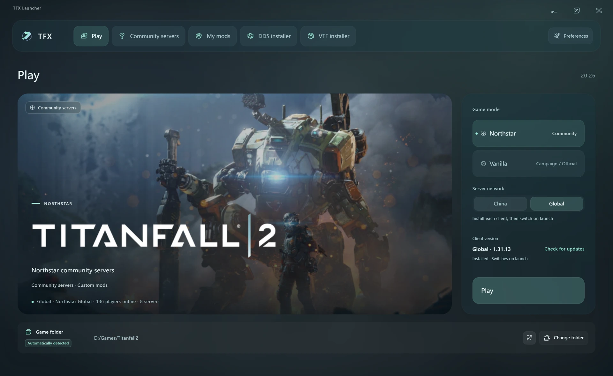
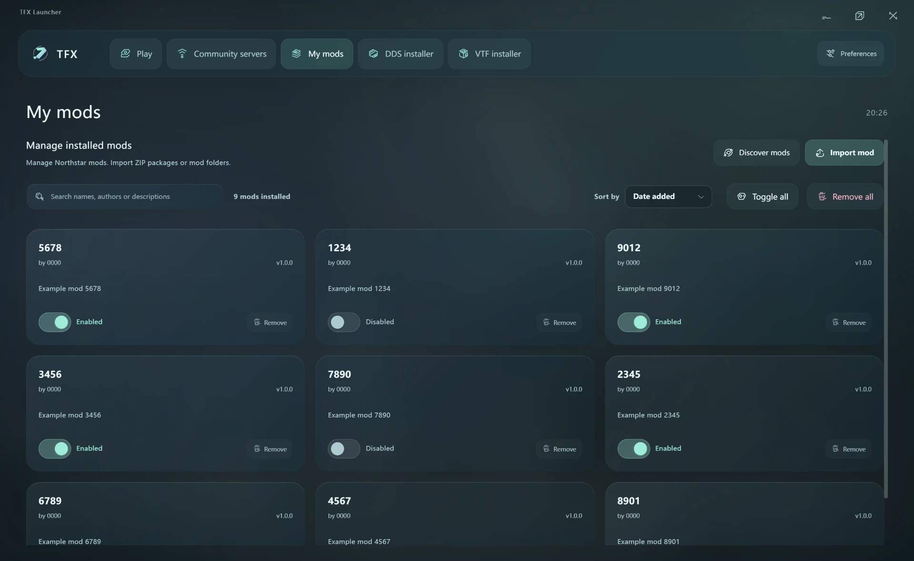
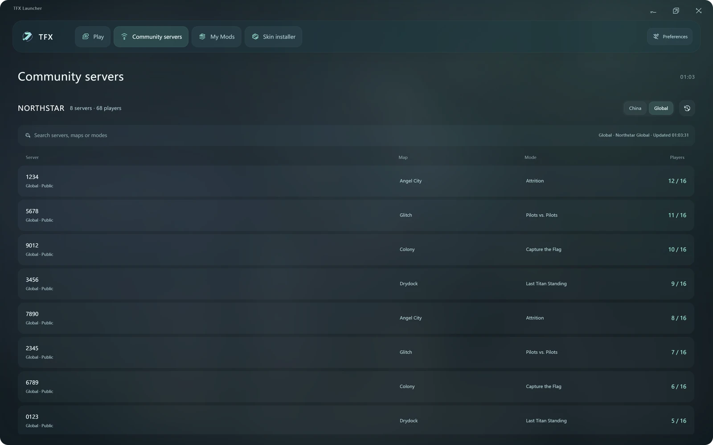
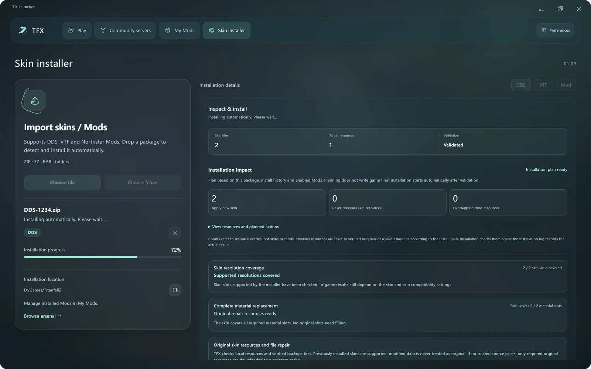
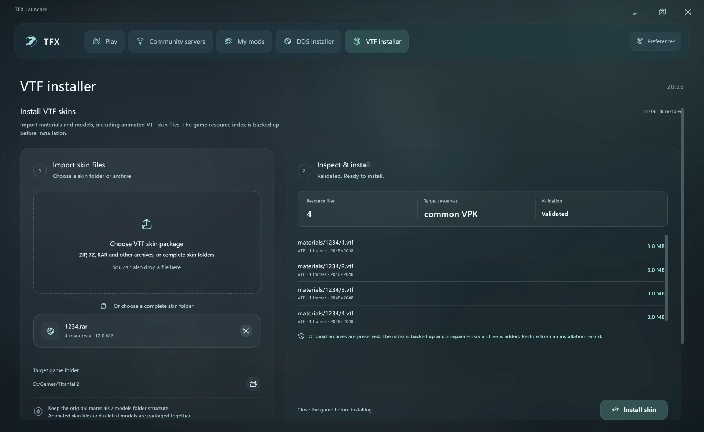
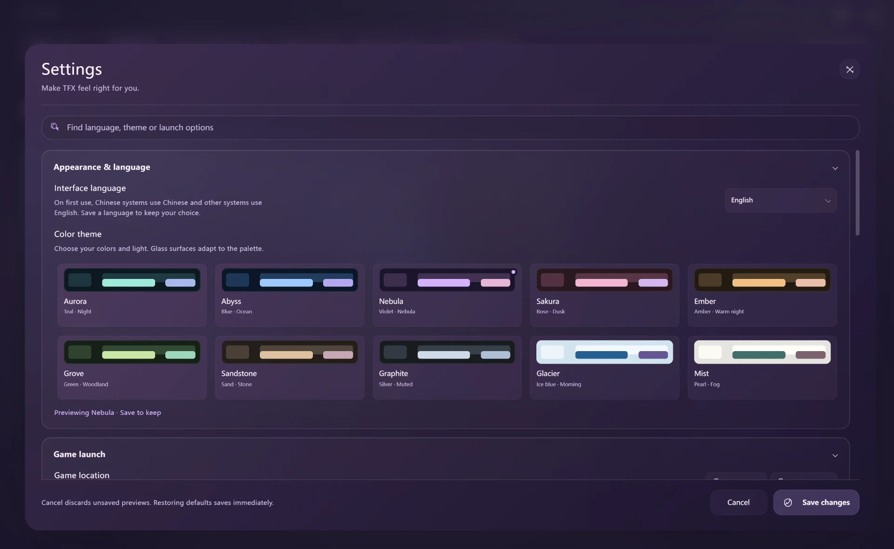

# TFX Launcher

**English** | [简体中文](README.zh-CN.md)

**Switch between Northstar's Global servers and NorthstarCN's China servers. Install DDS & VTF skins in one click.**

Play on both Northstar networks from the same TITANFALL 2 installation. Select Global or China and launch; TFX switches to the matching client files for you. Import a compatible DDS or VTF skin package, review the installation plan, and click **Install**. Skin replacement and recovery backups are built in.

**[Download for Windows x64](https://github.com/harrycaoguitar/TFX_Launcher_forNorthStar/releases/latest)** · [Report an issue](https://github.com/harrycaoguitar/TFX_Launcher_forNorthStar/issues) · [Build from source](BUILD.md)

<p align="center">
  
</p>

### Why try TFX?

| What you want to do | How TFX helps |
|---|---|
| Play on Global or China | Switch between **Northstar** and **NorthstarCN** from the launcher. Install either client here if it is missing. |
| Install a new skin | Import **DDS or VTF** skins and install with one click after validation. Compatible VTF archives can be ZIP, 7z, RAR, and more. |
| Replace a skin on the same weapon | Replace supported skins across **DDS and VTF** formats, clean up previous skin resources, and keep recovery backups. |
| Find servers and mods | Browse each network's public servers, search your installed mods, and download Thunderstore mods with their dependencies. |
| Make it your own | Choose **10 themes** and **5 languages** in a frosted interface, with an option to exit TFX after a successful launch. |

Windows x64 · Requires an installed copy of TITANFALL 2 · First-time client installation is separate from launch

### A closer look

Actual TFX 1.0.2 interface, shown in English. Numbered mods, skins, servers, and installation states are demonstration data; these images do not represent live server availability.

| Your mods, organized | Community servers at a glance |
|:---:|:---:|
|  |  |
| **DDS installation** · review the package before installing | **VTF installation** · use the same focused workflow |
|  |  |

<details>
<summary><strong>Make it yours — 10 themes and 5 languages</strong></summary>



Choose a theme and language in the app, then save your preferences.

</details>

<a id="en"></a>

## English

### Contents

- [Installation and first use](#en-start)
- [Launching and client management](#en-launch)
- [Community servers](#en-servers)
- [My Mods and Thunderstore downloads](#en-mods)
- [DDS and VTF skin installation](#en-skins)
- [Backups, restoration, and skin launch protection](#en-recovery)
- [Appearance, languages, and preferences](#en-settings)
- [Updates, storage, and troubleshooting](#en-help)
- [Building, support, and credits](#en-project)

<a id="en-start"></a>

### Installation and first use

#### Requirements

- A 64-bit Windows system. This release provides a Windows x64 build.
- A purchased, installed copy of TITANFALL 2 and a working Steam / EA launch environment. TFX does not include the game.
- Enough free space on the game and data drives for client installation, download caches, and skin recovery backups.
- Internet access for server browsing, Thunderstore, and update checks. Version 1.0.2 includes first-install data for both Northstar clients; installing a client does not make online play available offline.

#### Getting started

1. Download and run `TFX-Launcher-1.0.2.exe` from [Releases](https://github.com/harrycaoguitar/TFX_Launcher_forNorthStar/releases/latest).
2. TFX checks your saved location, Steam libraries, and EA installation information. If detection fails, use **Choose folder / Change folder** to select the game root containing `Titanfall2.exe`. Do not select `steamapps`, `common`, or a mod subfolder.
3. On first use, Chinese system languages select Simplified or Traditional Chinese as appropriate; other system languages default to English. Change this in **Preferences → Appearance & language** and save to keep your choice.
4. In **Play**, choose vanilla or Northstar. For Northstar, also choose **CN / Global**. If the selected client is not installed, install it before launching.

The portable EXE does not require a separate TFX installation, but it still saves preferences, caches, and recovery records. If using a directory build, run `TFX-Launcher.exe` and keep all files beside it. Opening TFX again focuses the existing window so multiple instances do not write to the same configuration at once.

<a id="en-launch"></a>

### Launching and client management

#### Vanilla game

**Vanilla** launches the EA version of TITANFALL 2 for the campaign and official multiplayer. Steam / EA may require a sign-in or launch confirmation during the initial handoff; complete these prompts in the relevant platform. Vanilla and Northstar community play have separate launch modes.

The home page shows the game folder and lets you open or change it. The end-game control can stop an unresponsive game process; forcing it to close may lose unsaved progress.

#### NorthstarCN and Northstar

**Northstar** offers two client channels:

| Selection | Client | First-install version bundled with 1.0.2 |
|---|---|---|
| CN | NorthstarCN | 1.17.7 |
| Global | Northstar | 1.31.13 |

TFX checks each client's actual files and installation state separately, showing states such as not installed, ready to switch, active, or repair required. A bundled archive or downloaded cache is not treated as an installed client.

- **First installation:** Use the selected channel's install button, wait for extraction and verification, and then launch. Installation and launch are separate actions.
- **Channel switching:** Once both clients are prepared, select the other channel and launch. TFX switches the corresponding core files while retaining personal mods, skins, and settings. Repeated launches of the same channel reuse prepared files to reduce extraction and copying.
- **Version detection:** The home page shows the selected client's actual version. A recognized newer local client is preserved rather than directly downgraded to the older bundled version.
- **Client updates:** The home page's update check targets the Northstar client. Preferences provide automatic updates, version refresh, reinstallation, and files to retain during updates. An uninstalled channel still requires an explicit first installation.
- **Protection while running:** Client switching and file replacement are blocked while the game runs. Changing the target folder or channel during installation stops the commit and handles recovery to avoid writing to the wrong destination.
- **Launch feedback:** TFX checks the game process and Northstar core-menu loading, and reports failure reasons. Closing the game quickly during startup releases the waiting state so you can retry.

To reduce background use during play, enable **Exit TFX after the game starts**. TFX exits after confirming the launch succeeded and stays open if it fails. This option is off by default.

<a id="en-servers"></a>

### Community servers

The **Community Servers** page in the sidebar presents the CN or Global public directory as a vertical list. Search by server name, map, or mode, and inspect player counts / capacity, descriptions, and required mods. Servers with more players appear first, using the page's shared scrolling area.

Data comes from each network's public server directory. You can refresh manually; relevant visible pages refresh about once a minute. Unnecessary polling pauses when the page is left, covered by a popup, or the window is hidden. Failed requests distinguish unavailable data from the last cached list rather than presenting old data as a new result.

The lower-left corner of the Northstar home page shows the selected network's public-server player count. This is a sum from the public directory, not a count of every player online. Displayed times and refresh timestamps use your computer's system time; player counts change with directory refreshes.

This list is for browsing. Launch the matching client and join through its in-game server browser. TFX does not join games directly from its server list.

<a id="en-mods"></a>

### My Mods and Thunderstore downloads

#### Installed mods

**My Mods** uses cards to show each mod's name, author, description, and state, with controls to enable, disable, or remove it. Search matches names, authors, and descriptions.

The sorting menu uses TFX's own interface and offers:

| Sort | Behavior |
|---|---|
| Added date | Recently added mods first |
| Name | Name order using the selected language's sorting rules |
| Enabled state | Enabled mods first, then name order within each state |

Toggles show saving status and the result; a failed save restores the actual state. List updates preserve the search and scroll position to reduce jumps to the top. Bulk toggle and removal controls are also available, with required core components protected.

#### Browse and download

Open **My Mods → Discover Mods** to browse [Thunderstore's Northstar community directory](https://thunderstore.io/c/northstar/). Search names and authors, and filter by category.

TFX plans dependencies, downloads and checks the installation content, and commits only after everything is ready. Downloads can be cancelled. Failures preserve or restore existing content rather than leaving only some dependencies installed. Native plugin installations require confirmation inside the app. Mod author information and package licenses are retained.

Thunderstore provides the catalog and packages. The catalog browser, dependency planning, download, installation, and management implementations were rewritten for this project; individual mods are provided by their authors.

#### Local imports

Use the import button or drag in files to install a **ZIP archive** or **complete mod folder** containing a valid `mod.json`. Imports check the definition, folder structure, and file paths. Damaged packages, unsafe paths, disguised core components, and DDS / VTF skins imported on this page produce explicit errors.

Local mod imports and VTF skin imports support different inputs: extract RAR / 7z mod archives into complete folders first. Install skins on the corresponding DDS / VTF page.

<a id="en-skins"></a>

### DDS and VTF skin installation

Each format has its own page with an **import → review the plan → install** workflow. Close the game before installing, then check the target folder and file list. Both pages provide progress, operation logs, and installation records.

| Page | Accepted inputs | Structure to retain |
|---|---|---|
| DDS installer | A `.dds` file, a ZIP containing DDS files, or a skin folder | Original DDS filenames used to match game resources |
| VTF installer | A complete skin folder, or a readable ZIP, 7z, RAR, or other supported archive with compatible assets | Original `materials / models` folder structure |

#### DDS installation

TFX checks DDS headers, compression formats, dimensions, recognized resource locations, and resolution coverage. The plan shows file counts, target resources, and validation results. Invalid formats or unmatched resources do not become ready to install.

Replacing a skin for the same weapon also handles resources covered by the previous skin. Parts omitted by the new package need reliable original data to restore them, preventing old lettering, sights, and similar details from remaining. If another tool has already changed the game and no trusted original backup is available, the page asks you to select original resource backups or open Steam verification and check again afterwards.

These checks use recognized game-resource layouts. They do not mean any DDS file, game version, or skin package can be installed directly; TFX reports the result for the selected package.

#### VTF installation

TFX checks compatible assets inside the archive rather than accepting a package solely because its extension is ZIP, 7z, or RAR. Animated VTF skins and associated models are supported. Content and folder checks precede generation of separate skin data and recovery records.

Damaged archives, packages without compatible files, and incomplete structures produce errors. Keep the author's `materials / models` structure instead of renaming everything or flattening it into one folder.

#### Switching skin formats

For the same weapon, DDS → VTF and VTF → DDS replacement share an installation workflow that handles previous resources and model entries and retains recovery records. Unconfirmed original data or unfinished installations require restoration or repair first.

Importing the wrong format clears the pending selection and reports the error; it does not install the previously selected package. If another tool changes game resources outside TFX, a trusted original state may need to be restored before installation can continue.

<a id="en-recovery"></a>

### Backups, restoration, and skin launch protection

#### Installation backups

DDS and VTF operations back up required resources before installation and verify writes afterwards. Each page initially shows the latest **5 records**; expand the history to view the rest.

- **Restore:** Restore the installation described by a record. When installations overlap, restore newer records first. Cross-format restoration handles the related DDS / VTF resources together.
- **Delete:** Each record has a delete control for completed historical backups that no longer support recovery. Backups required by the current skin, unfinished installation, or cross-format recovery cannot be deleted directly.
- **Locate:** Open the backup folder or read the operation log. Avoid manually removing files still needed by an active recovery workflow.

If the game starts, another program changes a target, or verification fails during installation, TFX stops committing and retains recovery information. Follow the page's recovery prompt for unfinished work; turning off launch protection does not bypass this check.

#### Skin launch protection

In **Preferences → Skin launch protection**, control pre-launch settings restoration for both DDS and VTF skins.

TFX records the current skin compatibility settings on the first skin installation. When protection is enabled, it restores those recorded values before a game launch from TFX. You can inspect the record, refresh its status, and record your current settings again after closing the game.

These are your recorded choices, not a fixed compatibility preset suitable for every skin. Confirm the skin displays correctly in-game before capturing a new record. Protection covers `setting.stream_memory` and `setting.mat_picmip`; it does not lock in-game graphics options and does not require an extra UI mod.

**The protection switch saves immediately.** Closing Preferences or choosing Cancel does not undo that switch. Unsaved previews of normal preferences such as theme and language can still be cancelled.

<a id="en-settings"></a>

### Appearance, languages, and preferences

#### Frosted interface and themes

TFX uses translucent frosted panels, rounded cards, and short page transitions. Navigation, Preferences, and action feedback have transitions, with reduced motion respected when enabled by the system. The outer window frame is rectangular. Drag its blank top area to move it, or double-click to maximize or restore it.

Preview ten palettes in Preferences: **Aurora, Abyss, Nebula, Sakura, Ember, Grove, Sandstone, Graphite, Glacier, and Mist**. The last two are light themes. Save to retain a selection; Cancel restores the appearance before the unsaved preview.

#### Five interface languages

Supported languages are **简体中文, 繁體中文, English, Deutsch, and Français**. The first-use language follows the system language rather than your IP or location. Non-Chinese systems default to English, including German and French systems. A manually saved choice takes priority. Language and mod-sorting menus use the app's own styling.

#### Preference controls

The search field at the top of Preferences finds language, theme, launch, and other options. Controls are grouped by purpose:

| Group | Available controls |
|---|---|
| Appearance & language | Interface language; preview and save ten themes |
| Game launch | Open / change game folder; Northstar arguments; exit TFX after launch; close Origin when TFX exits |
| Skin launch protection | Restore switch; view record; refresh status; capture current settings |
| Northstar updates | Automatic checks and updates; retained files; refresh version information; reinstall the selected client |
| Connection & network | Flush DNS cache; choose a DNS provider or automatic configuration and apply it explicitly |
| Maintenance | Clear installation cache; end game / Origin processes; restart TFX |
| About | Author; email; GitHub Issues; special thanks; version; TFX update check |

DNS tools change system network configuration only after an explicit action and confirmation. Applying a DNS change may require Windows administrator permission. Clearing installation caches means required packages will be fetched again later. Use process termination and reinstallation tools according to their prompts.

Normal preferences are saved only after **Save changes** writes successfully. If saving fails, Preferences remains open with your input retained. **Cancel** reverses unsaved previews.

#### Hold to restore defaults

**Restore default preferences** requires a continuous **2-second hold**. Releasing early, moving away, losing focus, or closing Preferences cancels it. Completion immediately saves default appearance, language, and launch preferences while keeping the game folder, cache paths, installed mods, and skins. It does not uninstall the app, delete the game, or restore original skins.

<a id="en-help"></a>

### Updates, storage, and troubleshooting

#### Two kinds of updates

- **Northstar client updates:** Update the selected channel's files in the game folder through the home page and Northstar update preferences.
- **TFX app updates:** **Preferences → About → App updates** reads [this repository's latest stable Release](https://github.com/harrycaoguitar/TFX_Launcher_forNorthStar/releases/latest). Results distinguish up to date, update available, no published release, and network failure. Choosing a download opens the official GitHub link; TFX does not silently replace the running app.

Releases provide the application, matching source archive, English acceptance and attribution document, and SHA-256 checksums. Use the release EXE. GitHub's automatically generated source download is for development, not a runnable Windows application.

#### Storage and cleanup

Preferences are stored in the Windows application data directory. Northstar download caches and client transaction data, Thunderstore caches, and some mod-state backups prefer `D:/TFX-Launcher-Data` when drive D: exists. DDS / VTF skin backups and cross-format recovery records remain under `fold-launcher` in Windows application data; client copies for fast switching use the `.tfx` area inside the game folder. Use **Open backup folder** on each skin page to locate its actual storage.

Recovery files support actual restoration workflows. Do not treat the entire application data directory or the game's `.tfx` directory as disposable cache.

To reclaim space, use **Maintenance → Clear installation cache** and deletable historical backups on the skin pages. Restoring default preferences preserves these resources.

#### Common issues

| Situation | Suggested action |
|---|---|
| Game not found | Select the root containing `Titanfall2.exe` and check that Steam / EA installation is complete |
| Northstar says not installed | Install the selected channel first; having one client does not mean both are installed |
| Launch requires platform confirmation | Finish the sign-in or launch confirmation in Steam / EA, then return to the result |
| Game process exists but the Northstar menu is unconfirmed | Close the game, read the launch error, check the selected client's state, and refresh or reinstall if necessary |
| Server list / mod catalog fails to load | Check connectivity and refresh later; cached counts and timestamps are not a current live result |
| DDS / VTF import errors or disabled install button | Use the matching page, retain names / structure, and read validation results and logs |
| Old skin parts remain or original data is missing | Restore existing records or supply reliable original backups; check again after Steam verification |
| Unfinished installation or dependent backup reported | Restore newer records as prompted and retain related backups; do not delete recovery files directly |
| Want lower launcher usage during play | Enable exit after launch and save; it applies on the next successful launch |

Steam verification repairs original game files and may overwrite modified skin resources. Follow TFX's instructions when arranging verification and restoration, then check the installation plan again. Third-party mods, skins, and online services are maintained by their authors; compatibility still depends on package contents, client versions, and service availability.

<a id="en-project"></a>

### Building, support, and credits

#### Development and builds

Use Windows x64, Node.js **22.12 or newer**, and npm. From the repository root:

```powershell
npm ci
npm test
npm start
# Build the Windows x64 portable application
npm run dist
```

See [BUILD.md](BUILD.md) for full requirements, outputs, and license handling. Keep the tools, client data, and licenses in `src/tools/`; they are needed for builds and offline first installation. Dependencies are pinned for the release. This repository's `npm test` covers 592 tests; the English acceptance and attribution document attached to the Release describes the scope and limits of actual-machine validation.

#### Support

Author: **HarryCao**.

For problems or suggestions, open a [GitHub Issue](https://github.com/harrycaoguitar/TFX_Launcher_forNorthStar/issues) or email **harrycaoguitar@gmail.com**. Include the TFX version, selected client, reproduction steps, and error text. Review logs for personal paths before sharing them.

#### Special thanks

| Acknowledgments |
|---|
| Northstar |
| NorthstarCN |
| Glock-雨夜 |
| HK560 |
| zxcPandora |

Thank you to these teams and contributors, and to everyone who tested TFX or provided feedback.

#### License and provenance

TFX is a **GPL-3.0-or-later** derivative of ViperCN 1.11.3. Mod management, Thunderstore browsing and installation, DDS / VTF installation, and dual-client management include new implementations written for this project. This work does not remove attribution, license, or corresponding-source obligations for inherited code, and does not make the entire application a clean-room rewrite.

See [LICENSE](LICENSE) for the project license and [THIRD_PARTY_NOTICES.md](THIRD_PARTY_NOTICES.md) for provenance and third-party notices. Official clients, downloaded mods, the Electron runtime, fonts, and archive tools retain their own licenses. The Global client bundled with 1.0.2 omits the optional Discord Rich Presence plugin because its redistribution license was not clearly declared. Core client files and the community-server menu remain included; full updates downloaded from official releases are installed with their official contents.

TFX is a community project and is not affiliated with or endorsed by Respawn Entertainment or Electronic Arts. The TITANFALL 2 name, logo, and game assets belong to their respective rights holders.
